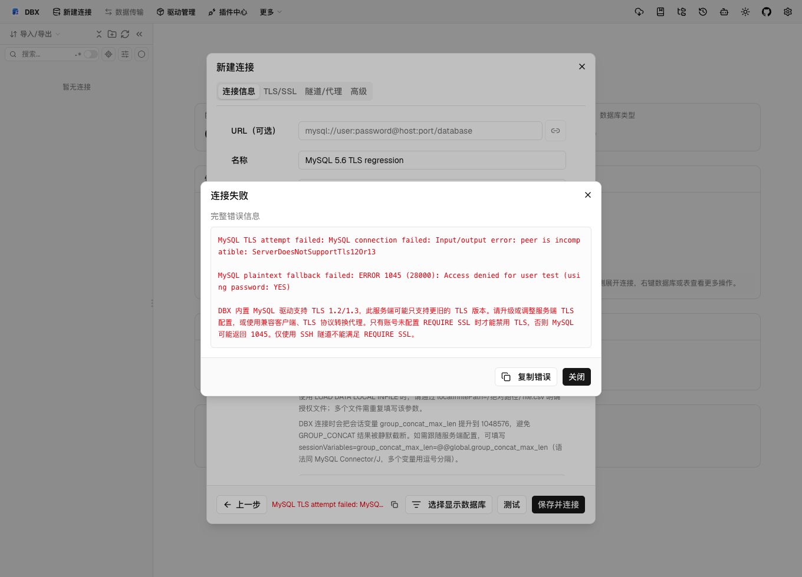

# Verification: MySQL TLS diagnostics

Issue: https://github.com/t8y2/dbx/issues/13265

Pull request: https://github.com/t8y2/dbx/pull/13294 (submitted, not merged).

Base: `0297c5ecf9d727b18e918175d1bcc2f8aa08f08f` (upstream main).

## Results

| Check | Result |
| --- | --- |
| `cargo test -p dbx-driver-mysql --locked` | 299 passed, 4 pre-existing live-environment tests ignored; doctests passed (0 cases) |
| `pnpm test --maxWorkers=4` | 1,963 files, 26,313 tests passed |
| `NODE_OPTIONS=--max-old-space-size=8192 pnpm typecheck` | Passed |
| `cargo clippy -p dbx-driver-mysql --all-targets --no-deps --locked -- -D warnings` | Passed |
| `rustfmt --edition 2021 --check crates/dbx-driver-mysql/src/mysql.rs` | Passed |
| `pnpm exec oxfmt --check` on changed TypeScript files | Passed |
| `pnpm exec oxlint --vue-plugin` on changed connection hint/test files | Passed |
| `git diff --check` | Passed |

## Regression evidence

- Before the driver fix, the exact reported error failed the classifier test;
  real rustls wire tests also failed Preferred fallback/failure-preservation cases.
  A synthetic TLS 1.0 ServerHello reproduces `ServerDoesNotSupportTls12Or13`
  through the production mysql_async connector. The server is not a mocked
  retry function. Strict-mode tests already passed and remain passing.
- Successful Preferred fallback returns a pool that can be checked out and
  pinged again. A fallback that then requires the legacy-EOF retry retains both
  the initial TLS error and the final 1045, with the expected capability flags.
- Frontend regression additions initially produced 10 failures in the existing
  hint suite. The final hint suite has 30 passing cases and preserves missing
  password, certificate, non-MySQL, alias, native error, and idempotency behavior.
- Independent review found one P2: persisted configs can omit a transient
  password. Its new regression failed before accepting native `(using password:
  YES)` evidence and passed afterward. Native NO retains missing-password
  priority; absent password-use evidence is not guessed.
- The wire tests use a single-connection pool to keep the fixture focused on
  retry behavior. A test-only direct reference to the already locked rustls
  initializes the same AWS-LC provider as the application entry points; no
  dependency version or runtime TLS backend changed.

## Initial-run limitations and reruns

- The initial 8-worker frontend run had two failures: the unchanged
  `legacyWebviewFallback.spec.ts` scrollbar case exceeded 10 seconds, and the
  unchanged `sqlSyntaxTreeWindow.spec.ts` multi-statement case returned null.
  Both passed in an independent one-worker run and the complete 4-worker rerun.
  No changes were made to those tests or their production code.
- Default-heap type checking exhausted the Node heap. The complete check passed
  with the explicit 8 GB heap limit above.
- Dependency-inclusive Clippy with Rust 1.95 stopped on three unchanged
  `dbx-sql-core` warnings: `nonminimal_bool` in
  `object_source_sql/oracle_routines/analysis.rs:442` and `collapsible_match` in
  `sql_analysis.rs:1486` and `sql_analysis.rs:1517`. The strict MySQL-only check
  passed. These unrelated files were not modified.

## Screenshots and scope

The screenshot uses the real Vue application and connection error dialog with
Playwright-intercepted local HTTP errors and synthetic credentials. They verify
UI rendering, not a live MySQL server or production deployment. The focused
browser session also encountered unrelated startup warnings/errors because it
used a minimal mock backend, not a complete DBX Web server.

The Disabled-mode browser snapshot also confirmed the conditional 1045 hint,
SHOW GRANTS guidance, and SSH/REQUIRE SSL distinction in the actual error dialog.

No TLS 1.0/1.1 support is introduced. No live legacy MySQL, REQUIRE SSL account,
cross-platform runtime, multi-connection pool lifecycle, or deployment acceptance
is claimed. Translation technical content/token safety was reviewed across all
14 locales, not independently certified by native speakers.
